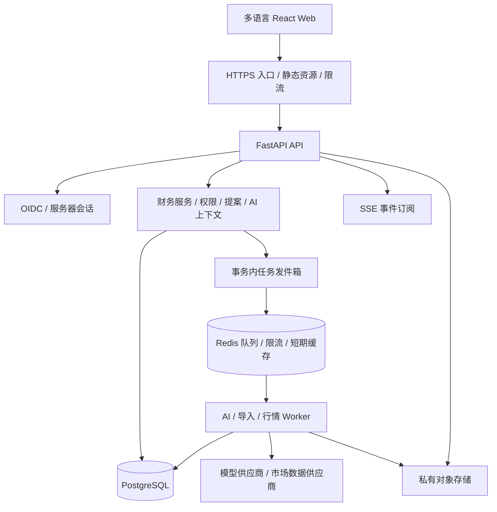

# FinUnity Web / Server 完整改造方案

日期：2026-10-19。状态：架构与实施方案，尚未实施业务改造。

## 1. 目标与已经确认的范围

将 Aurelio 的个人财务管理和 AI 交互闭环，调整为面向全球用户、多语言优先的多用户 Web 服务。首期专注浏览器与服务器，不开发原生客户端。

保留的产品效果：资产全景、现金流、目标规划、基金穿透、带上下文的 AI 对话、确认卡片、按需深入分析。

首版假设：邀请制试运营；平台托管模型凭据；手动录入和标准文件导入优先；无真实证券下单；先在一个选定区域部署。首版支持英文、简体中文，技术结构允许增加语言。上线区域、数据提供商及允许服务的地区，需要在公开上线前确定；全球产品设计不等于首日向所有地区开放。

## 2. 核心决策

| 事项 | 决策 | 原因与代价 |
| --- | --- | --- |
| 应用架构 | 模块化单体，API 与 Worker 独立进程 | 复用现有 Python 业务，减少服务间一致性问题；需要严格执行模块边界 |
| Web | 保留 React / TypeScript / Vite | 现有交互可逐步迁移；公开营销站如有 SEO 需求，可独立建设 |
| API | 保留 FastAPI，统一 `/api/v1` | 复用 Pydantic 和 OpenAPI 类型生成 |
| 数据库 | PostgreSQL，共享库共享表，按财务空间隔离 | 支持事务、并发、约束和 RLS；不为每个用户维护独立数据库 |
| 后台任务 | Celery + Redis，业务任务状态以 PostgreSQL 为准 | 使用成熟任务机制；允许重复投递，业务层必须幂等 |
| 文件 | S3 兼容私有对象存储 | 原始导入文件、导出文件与数据库分开；按权限签发短期下载地址 |
| AI 编排 | 先保留 Python 显式编排，补持久化状态和预算 | 不同时重写业务和引入新的图框架；后续有复杂恢复需求再评估 LangGraph |
| 登录 | 成熟 OIDC 身份服务，Web 使用服务器会话 | 不自行实现密码存储与找回；服务器控制会话撤销 |
| 部署 | 同源 Web/API，容器部署，独立 Worker | 减少跨域复杂度，便于 SSE 和会话管理 |
| 流式交互 | POST 创建任务，GET SSE 订阅任务事件 | 任务独立于浏览器连接，可刷新恢复 |
| AI 付费 | 用户/空间配额与实际用量记录先行 | 首版不必接订阅支付，但必须控制并发与成本 |

版本以实现时验证过的兼容组合锁定，不随本方案盲目升级所有依赖。Python 先遵守项目已有版本约束，在 CI 中选择一个明确运行版本验证。

## 3. 总体架构与状态边界



PostgreSQL 保存业务事实、提案、任务、事件和用量。Redis 不保存唯一一份账本或正式报告。Worker 负责长耗时操作；API 做认证、授权、参数校验、短事务和任务准入。浏览器只展示服务端状态，不决定用户归属、权限、可投资金额或提案执行结果。

首版不引入微服务、Kubernetes、专用向量库。结构化财务查询使用 SQL 和确定性计算。将来增加大量非结构化研究资料时，再单独设计 RAG，不把账本转成向量后替代准确查询。

## 4. 多用户模型：用户与财务空间分开

`User` 是登录身份；`Workspace` 是一份有权限边界的财务集合。用户注册后自动创建个人空间，之后可加入家庭空间。不同空间的数据默认互不可见，首版不提供跨空间自动汇总。

```text
User ── Membership ── Workspace
                        ├─ Institution → Account
                        │                  ├─ CashAnchor
                        │                  ├─ Snapshot → Holding
                        │                  └─ Transaction
                        ├─ Transfer / CashflowRule / CashflowOccurrence
                        ├─ RealAsset / Liability / Goal / Plan
                        ├─ Conversation / Proposal / AnalysisRun
                        └─ ImportBatch / AuditEvent / UsageRecord
```

机构和账户分离：同一家银行可有多个账户，证券账户可有多币种现金子余额。现金锚点的归属至少为 `account_id + currency + effective_date`；不能假设一个账户永远只有一种币种。资产归属与系统访问权分开，记录所有人不自动授予其登录权限。

默认角色：

| 操作 | Owner | Editor | Viewer |
| --- | --- | --- | --- |
| 查看共享账目 | 是 | 是 | 是 |
| 新建、修正财务记录 | 是 | 是 | 否 |
| 启动 AI | 是，受配额约束 | 是，受配额约束 | 默认否，可单独授权 |
| 确认本人 AI 提案 | 是 | 是 | 否 |
| 管理成员、空间预算 | 是 | 否 | 否 |
| 导出数据 | 是 | 默认否，可授权 | 默认否，可授权 |
| 删除空间 | 是，重新验证身份 | 否 | 否 |

聊天、个人画像、AI 报告默认仅本人可见，即使财务数据属于共享空间；财务空间的 Owner 不因身份自动获得别人的私人聊天或画像。首版不做任意账户级 ACL；有私密账户的用户放在另一个私人空间。共享报告是显式动作，发布的是允许共享的版本，避免将私人画像或对话一并暴露。

首版提案只允许发起人本人确认；不支持审批链和代批。家庭协作有需求后再增加明确的审批授权。

## 5. 数据隔离必须覆盖完整调用链

现有 `get_or_404` 通过 `db.get(model, id)` 取对象，`crud`、统计和 AI 上下文也以全库为边界。这些入口需要一起调整，不能只给页面接口补 `user_id`。

采用三层约束：

1. API 根据服务器会话构建 `ActorContext(user_id, workspace_id, role, capabilities, request_id)`，校验真实成员关系；不信任请求体、模型参数或队列参数中的身份声明。
2. 业务服务与 Repository 显式接收作用域，读写都带空间范围。子资源必须通过已授权父对象定位。
3. 私有业务表启用 PostgreSQL RLS，查询和写入策略覆盖 `USING` 与 `WITH CHECK`。额外按作者限制私人会话、画像和报告。

RLS 具体约束：应用使用非表所有者、非超级用户、无 `BYPASSRLS` 的运行角色；迁移与运维使用独立角色。需要时对表启用 FORCE RLS。每个短事务验证成员资格后设置 transaction-local 上下文；事务结束自动清除，未设置时默认拒绝。RLS 是应用层遗漏的防线，不替代身份验证，也不宣称可抵御持有数据库凭据的攻击者。

业务子表保留 `workspace_id`，通过 `(workspace_id, parent_id)` 复合外键防止跨空间关联；唯一约束根据含义限定在空间内。供应商凭据、会话、邀请、任务事件、文件路径、CSV 导出、缓存、模型上下文和报告查询全部纳入隔离范围。

Worker 从数据库加载任务与发起人，执行前重新校验权限与空间状态。成员移除后撤销会话/订阅，在下一次工具调用和提交前再次校验。共享行情任务使用不同服务角色，只允许修改公共行情数据，不能借此读取任意私人账目。

公开市场数据可共享缓存；私人汇总、个人回答和 AI 上下文绝不跨空间复用。持仓组合本身属于私人数据，即使价格公开也不能暴露“谁关注了什么”。

PostgreSQL 的表所有者通常绕过 RLS，参见 [官方 RLS 文档](https://www.postgresql.org/docs/current/ddl-rowsecurity.html)。

## 6. 数据表调整

| 数据组 | 建议实体 | 主要变化 |
| --- | --- | --- |
| 身份与协作 | users, auth_identities, sessions, workspaces, memberships, invitations | 用户身份、空间成员和邀请生命周期 |
| 财务记录 | institutions, accounts, snapshots, holdings, transactions, cash_anchors, transfers | 空间归属、独立账户、精度、来源与版本 |
| 收支 | cashflow_rules, cashflow_occurrences | 计划规则与实际收付分离 |
| 规划 | goals, plans, plan_targets, plan_occurrences | 计划执行状态与真实成交分离 |
| 个人信息 | user_preferences, profiles, profile_answers | 语言/时区与个人画像，默认私人 |
| 空间设置 | workspace_settings | 基础币种、财务日界线、共享规则 |
| 市场数据 | instruments, listings, quotes, fx_rates, compositions, provider_status | 公共目录、来源、时间、覆盖度 |
| AI | conversations, messages, proposals, analysis_runs, analysis_steps, tool_calls | 私人访问策略、结构化提案、步骤状态 |
| 执行可靠性 | jobs, job_events, outbox_events, idempotency_records | 投递、恢复、订阅与去重 |
| 运营 | usage_records, quota_reservations, audit_events, import_batches, export_jobs | 成本、审计、导入与导出 |

业务表按需使用 UUID、`created_at/updated_at`、`created_by`、乐观锁 `version`。UUID 不承担授权职责。时间戳使用带时区 UTC；财务生效日期使用独立 DATE；市场交易日由挂牌市场日历决定。

金额建议使用 `NUMERIC(28,8)`，数量和价格可使用 `NUMERIC(28,12)`，进入实现前按目标资产范围核对精度上限。Python 使用 Decimal；API 中金额/数量以十进制字符串传输。显示时依币种和地区格式化，汇总中间步骤不逐行四舍五入；明确 JPY、KWD、加密资产等不同精度。图表可转换为展示用数值，不能回写为账本事实。

税务居住地、语言、币种和时区不互相推断。首版税率只接受用户明确声明的估算设置，不提供跨国自动报税引擎。

## 7. 财务引擎：保留核心规则，补服务器约束

继续采用“快照 + 之后事件”，明确快照是空间财务日界线下的日终记录，同日事件不重复叠加。界面必须告知此含义；需要日内对账时再引入明确的截止时刻，不能悄悄改变比较符号。

保留现有原则：成本未知保持未知；原币金额不能直接相加；历史金额使用相应日期汇率；估值、行情、汇率标注来源与时间；证券身份与报价身份分开；无法报价不等于不存在；资产从新快照消失时提示差异。

额外增加：

- `record_state = planned / estimated / confirmed / voided`。计划和未确认估算不进入实际净资产、现金余额与已实现盈亏；预测视图单独展示。人工录入可以直接确认，导入通过批次预览确认。
- 原项目 `pac.py` 会按计划和市场收盘价生成估算交易。服务器首版将它改为产生待确认执行记录或预测，不自动假定用户真的买入。
- 实际收入/支出使用 occurrence；循环规则只产生待发生项或预测。避免按月计划自动冒充实际到账。
- 买卖、手续费、现金结算和对应转账在同一个领域命令事务中落库，防止只写一半。
- 跨币种转账记录两端真实金额、币种和费用；内部转账不计作收入，不改变整体净资产，费用除外。
- 对已确认财务记录的修正保留变更版本或冲销关系与审计，不用无痕覆盖。明确 V1 是资产与现金流管理系统，未声称具备完整会计总账。
- 所有产生财务事实的命令都有业务幂等键；导入去重不只比较日期与金额，允许真实的同日同额交易。
- 基础币种变更只改变展示和派生计算，不重写原币事实；历史图表标明币种和汇率口径。
- 所有聚合携带 `as_of`、数据修订号、缺失项和覆盖度；无法转换的资产单列，不能静默排除后把部分和叫作完整净资产。

行情刷新只更新估值缓存，不增加买卖或改变实际持仓数量。

## 8. AI 驱动的完整产品闭环

首版入口包括财务概览、账户、投资组合、现金流、目标、个人设置及持续可用的 AI 面板。AI 支持自然语言录入、解释数字、发现数据缺口、分析目标与资产结构；普通 Web 表单仍可使用，并调用相同的领域命令。

### 8.1 AI 权限与上下文

工具分三类：读取工具、财务修改提案工具、消耗预算的分析任务工具。每个工具声明所需能力、参数 schema、可见数据、资源上限和返回来源。工具服务器注入 ActorContext，模型不能选择用户、空间或数据库。

页面只传 `page_type + resource_id + selected_ids` 等结构化定位；服务器校验权限后构建上下文。客户端提交的页面文字、上传内容、网页和模型回复都是不可信数据，不能作为系统权限指令。

每次任务记录财务数据修订号、估值时间和上下文版本。深度分析读取一份固定输入包，避免分析前后混用两份数据；报告生成时若数据已改变，标注其分析时点。最新行情属于独立估值修订，不让报价跳动使普通记账提案无意义地失效。

当前用户的私人画像仅进入其自己的对话与分析；其他家庭成员看不到。深度分析的分角色上下文通过代码构建，不允许聊天模型自行给分析师转述全部用户对话。自然语言步骤输出仍可能携带信息，因此这种角色边界用于减少偏差，不被当作数据保密边界。

### 8.2 对话与分析状态

```text
对话任务：queued → running → completed / failed / cancelled / interrupted
提案：pending → applied / rejected / stale / expired
分析：queued → analyst → fit_review → revision? → synthesis → completed
```

分析师读财务数据及允许的市场查询；适配角色读当前用户画像和必要的分析摘要；有争议才修订，最多两轮；综合输出保留分歧。首版保留现有 3～6 步的有界结构，每步工具轮数、搜索次数、token 和耗时均有限额。模型未给分支标记时按“仍有争议”处理，并受总上限约束。

每个步骤独立持久化为 completed 后才进入下一步；正式报告只有综合完成后发布。失败步骤可展示状态，不能伪装成完整报告。恢复已完成步骤无需重新付费；对“已请求但不知供应商是否成功”的步骤标为 interrupted/unknown，先核对请求记录，不能自动无限重放收费调用。

首版“主动 AI”限于确定性触发：导入完成、确认财务变动、目标临近、用户设定的周期评估。先做规则检查，只有用户开启且预算允许才调用模型；任务有去重与冷却时间，发现问题先在 Web 收件箱呈现。不做持续无限扫描或未经配置的自动财务写入。

### 8.3 提案与并发确认

把现有消息 JSON 中的卡片抽成 `proposals` 正式表，至少保存：空间、发起人、工具、版本化参数、变更前后摘要、依赖版本、状态、有效期、确认人、结果及审计关联。

确认流程在短事务内完成：验证身份与当前权限 → 锁定 pending 提案 → 检查依赖记录版本 → 执行统一领域命令 → 标记 applied → 写审计和后续事件 → 提交。同一提案被双击或并发确认，只产生一次效果；已成功的请求返回同一结果。数据已变化返回 409，并允许重新生成。

依赖版本检查与写入需要原子性：首版可锁空间级财务 revision 行统一串行化短写入，所有财务写入都遵守同一顺序；当写入量成为瓶颈后再细化为账户级/资源级锁。不能先在事务外检查指纹再无条件写入。模型调用永远不持有这类数据库锁。

轻量新增展示摘要；修改历史快照展示逐项差异；撤销通过可追溯修正执行。服务器自动化的动作权限由配置明确授予，不能由 AI 自行扩大。

### 8.4 成本与模型治理

服务器托管模型密钥，浏览器不可读取。增加供应商适配层，先复用 OpenRouter 实现，模型清单由平台配置并验证工具、流式和输出能力，不把所有供应商暴露为用户任意字符串。

限额至少包括：单用户请求频率、每空间并发任务、单任务 token/步骤/搜索上限、每日/月度预算、平台全局预算和供应商并发。准入时原子预留额度，结束后按返回用量结算；预留不是最终扣款。响应或账单缺失时记为未知/待核对，不记为零。未知费用保留保守预留并进入对账流程，不因断线立即释放全部预算。

财务账本、AI 消费用量和将来的订阅账单分开。首版可采用管理员配额；订阅支付和 BYOK 后续独立加入。建议用户与空间同时设上限，避免更换空间绕过用户限额。

提示词、工具 schema、模型标识、输入修订号、费用和输出版本关联留存；普通日志不记录整份提示词或财务数据。工具禁止任意 SQL、系统命令和任意 URL 抓取；网络工具按允许来源、出口、大小及超时限制执行，防止用户资料/网页内容诱导越权。

## 9. 长任务、恢复与 SSE

创建任务采用业务事务写 `jobs + outbox_events`；分发器投递队列并记录结果。投递与确认间崩溃可能导致重复投递，因此消费者必须在数据库领取任务，使用租约、心跳和唯一键避免重复落库。过期租约可恢复，但收费模型调用按上一节的未知状态规则处理。

AI、导入、共享行情分别设队列和并发上限，避免慢行情阻塞聊天。定时器只运行一个有效调度实例，扫描持久化到期记录并幂等入队；不能每个 API 进程启动一套循环线程。

Celery 的晚确认不能替代业务幂等，参见 [官方任务文档](https://docs.celeryq.dev/en/stable/userguide/tasks.html)。

事件包含 `run_id, event_id, sequence, type, payload, created_at`。完成步骤、提案、结果和终态持久化；文本增量按批次持久化，不为每个 token 写一行。提交持久事件后再广播；Redis 可作通知加速，恢复依据仍是数据库。

POST 返回任务 ID；SSE GET 从已授权任务订阅，使用 event ID 补发。浏览器刷新/断线不取消任务；另设取消接口。取消采用协作式检查，已经提交的财务事务不会被半途回滚，已发生模型费用如实保留。事件过期时提供完整消息/报告快照重新同步，而不是重新执行模型。

SSE 端点重新校验访问权，不使用 URL 中长期 token。设置心跳、代理不缓冲、合理空闲超时和慢客户端上限。成员权限被撤销后终止订阅。原生 EventSource 支持事件 ID 与重连，参见 [MDN SSE 文档](https://developer.mozilla.org/en-US/docs/Web/API/Server-sent_events/Using_server-sent_events)。

## 10. 全球化与市场数据

### 10.1 五个独立设置

`language` 控制文案与 AI 回复；`locale` 控制数字和日期格式；`timezone` 控制用户时间展示；`base_currency` 控制空间财务汇总；`tax_residency` 是用户明确填写的税务信息。

空间另有固定财务时区/日界线，保证跨时区家庭看到同一份日终账目。市场收盘和交易日使用交易所时区，不能使用服务器本地日期。时间改变与夏令时需要回归用例。

前端所有 UI 文案使用翻译键，错误响应使用稳定 `code + params`，不依赖英文字符串判断业务状态。数字格式使用 Intl，日期明确时区；长文案、复数、缺少翻译回退、键盘访问均纳入测试。架构兼容 RTL，首版只对实际提供的语言承诺质量。

AI 系统指令可以统一维护，输出语言由用户设置明确指定；工具 schema 和持久化枚举不翻译，卡片字段通过 UI 翻译。用户原始资产名、备注、法律名称和来源标题保留原文。金额生成结构化字段后按本地格式展示，避免模型随意改变小数分隔符。

### 10.2 产品身份与挂牌身份

`Instrument` 保存金融产品身份、资产类别及可用 ISIN 等标识；`Listing` 保存交易所、MIC、ticker、报价币种、价格单位、供应商符号和交易日历。ISIN 可为空，不能强制所有资产都有 ISIN；加密资产需区分网络/合约与交易对。

现金资产无需行情代码；无法匹配的持仓可保留人工估值。公募基金净值、证券收盘价和加密交易价格属于不同数据语义，适配器不能伪装成统一的实时价格。GBP/GBp 等单位差异保留明确换算。

### 10.3 数据供应商与覆盖承诺

通过 `InstrumentSearchProvider / QuoteProvider / FXProvider / CompositionProvider / CorporateActionProvider` 接口隔离供应商。现有 Yahoo、ECB、justETF、发行商适配可继续用于验证，但用于多人服务前必须确认许可、再分发、调用限额和覆盖范围，不能把本地可抓取等同于可公开商业使用。

首版建立“资产类别 × 市场 × 能力”覆盖矩阵，分别标注：手动记录、标的搜索、日行情、分红、成分穿透。可先支持任意市场手动记录，再按已验证数据源逐项开放自动能力。界面展示供应商、更新时间、缺失值和覆盖比例。

公共缓存按标的、挂牌、来源、日期、币对等语义键设计；基金穿透的部分持仓不能冒充完整持仓，保留未知权重。刷新失败可返回旧数据并标记过期；质量较差的新数据不能覆盖更完整旧数据。共享任务合并同一标的刷新，限制供应商频率，避免每个用户重复请求。

外汇保存原始币对、日期和来源；不能假设所有币种都经过欧元。公司行动区分拆股、分红、复权价格与实际成交价，持仓盈亏和历史走势图不能混用不一致的价格口径。

## 11. Web 改造范围

保留现有资产与聊天交互，增加：登录/退出、空间切换、成员管理、语言/地区/时区设置、首次财务录入、数据覆盖提示、导入预览、后台任务中心、AI 配额展示和报告历史。

先保留现有组件逐页迁移，新增清晰的 URL 路由；不要一次重写全部 UI。切换空间时终止旧订阅、清空私人查询缓存和选中对象，重新获取权限；查询键含空间 ID、资源及视图口径。每个异步响应验证仍属于当前空间后再更新界面。

聊天流式文本与最终报告分开显示；消息旁提供来源时间、必要假设和待补数据。卡片清楚区分“记录一笔”“修改历史”“加入观察清单”，语言不能让用户误以为买卖已经发生。

会话使用 Secure、HttpOnly、SameSite Cookie；所有有副作用请求检查 CSRF/Origin。相对路径与同源部署继续保留。登出和会话过期清除浏览器私人缓存，不把长期访问凭据放 localStorage。OIDC 回调校验 state/nonce，并使用 PKCE；重新登录不恢复未经确认的执行动作。

模型 Markdown 不允许任意 HTML，外链与文件下载受控。报表导出防止表格公式注入；上传校验大小、内容类型和解析资源上限，禁止解析器任意访问网络或执行宏。

## 12. API 草案与错误约定

```text
/api/v1/auth/*
/api/v1/me/preferences
/api/v1/workspaces
/api/v1/workspaces/{wid}/members
/api/v1/workspaces/{wid}/accounts
/api/v1/workspaces/{wid}/snapshots
/api/v1/workspaces/{wid}/transactions
/api/v1/workspaces/{wid}/transfers
/api/v1/workspaces/{wid}/cashflows
/api/v1/workspaces/{wid}/goals
/api/v1/workspaces/{wid}/portfolio
/api/v1/workspaces/{wid}/conversations
/api/v1/workspaces/{wid}/conversations/{cid}/messages
/api/v1/workspaces/{wid}/proposals/{pid}/confirm
/api/v1/workspaces/{wid}/proposals/{pid}/reject
/api/v1/workspaces/{wid}/analysis-runs
/api/v1/workspaces/{wid}/runs/{rid}
/api/v1/workspaces/{wid}/runs/{rid}/events
/api/v1/workspaces/{wid}/runs/{rid}/cancel
/api/v1/workspaces/{wid}/imports
/api/v1/workspaces/{wid}/exports
/api/v1/market/instruments
```

不允许访问的资源通常返回统一 404，避免泄露其存在；已知范围内的能力不足返回 403。409 用于版本冲突和陈旧提案，429 用于配额或频率限制；用户提示通过稳定错误码翻译。响应携带 request ID，用户可据此反馈。

写操作接受 Idempotency-Key，按空间、发起人和操作范围保存请求摘要、状态与结果；相同键不同内容返回冲突。列表采用有上限的分页；报告、导出和昂贵计算异步返回 202。继续从 OpenAPI 生成 TypeScript 类型。

## 13. 代码组织及现有文件迁移

```text
backend/app/
  identity/         登录、会话、邀请
  workspaces/       成员关系、作用域、权限
  finance/          账户、快照、交易、现金流、资产、负债、目标
  valuation/        dated、positions、估值、汇总、金额和汇率
  market/           标的、挂牌、供应商、行情、成分缓存
  ai/               context、gateway、chat、tools、proposals、analysis
  jobs/             分发、执行、恢复、事件、调度
  imports/          上传、解析、预览、映射、提交、导出
  operations/       用量、配额、审计、健康检查
  infrastructure/   DB、Redis、对象存储、配置
  api/v1/           路由、依赖、响应与错误
```

按模块迁移而非先移动所有文件；每次保持可运行。

| 当前代码 | 调整重点 |
| --- | --- |
| models.py / schemas.py | 空间/账户归属、Numeric、版本和来源；明确公共与私人表 |
| database.py / Alembic | PostgreSQL、事务内作用域、RLS；迁移移出 API startup |
| crud.py / routers/deps.py | 消除无作用域 db.get/全表查询；统一领域命令和父对象授权 |
| dated.py / positions.py / analytics.py | 保留算法并注入空间、as_of、财务日界线与金额类型 |
| pac.py | 自动估算改为待确认或预测，迁入调度 Worker |
| prices.py / fx.py / composition.py / catalogue.py | 供应商适配、公共缓存、数据覆盖和刷新任务 |
| advisor.py / screen.py | ContextBuilder 显式接受 ActorContext 和已授权页面定位 |
| chat.py | 会话私有权限、持久任务、事件恢复与并发控制 |
| tools.py | 按财务领域拆工具；单独 ProposalService；统一写入与原子确认 |
| chain.py | 保留角色/有界分支，增加分析步骤检查点和冻结输入包 |
| model_list.py / main.py | 删除依赖进程内线程的公共调度；启动仅做校验和服务就绪 |
| mcp_server.py | 首版不暴露；后续通过服务器 API 鉴权与作用域接入，不能直接读取全库 |
| App.tsx / api/client.ts | 登录、路由、空间上下文、i18n、错误码和任务订阅 |
| 前后端现有 tests | 迁移为有空间 fixture，保留财务边界回归，增加 PostgreSQL 集成验证 |

## 14. 部署、运维与数据生命周期

开发环境用容器编排启动 PostgreSQL/Redis/对象存储替身；API 与 Web 保留本地开发方式。生产优先托管 PostgreSQL 与对象存储，应用、Worker 和调度器分别运行。首版可单区域部署，应用靠近数据库；静态文件可全球分发，私人 API 不放公共缓存。

数据库迁移由部署流水线中的单独步骤执行，使用迁移锁，不让多个 API 副本同时升级表。使用 expand → backfill → validate → contract，避免一次发布同时删除旧字段和切换全部代码。数据库备份不是迁移回滚方案的替代；数据格式改变需准备向前修复与可恢复副本。

秘密从部署密钥管理注入，不进入 Git、日志或 API。应用日志包含 request/run/workspace 标识，但不默认包含金融明细、私人备注或模型原文；运营人员默认没有私人账本读取权。必要支持访问必须临时授权并审计。

至少监控：API 延迟/错误、连接池、队列等待、租约过期、任务失败、SSE 重连、行情过期、模型 token/费用、预算拒绝及导入失败。用户账目变更、提案确认、成员变化、数据导出和支持访问形成追加式审计记录。

备份加密、与主服务故障域分离，定期恢复演练。试运营目标可设 RPO ≤ 24 小时、RTO ≤ 4 小时；正式收费前再确认更严格目标及对应成本，不把尚未演练的目标当承诺。

隐私生命周期分开设计：聊天/报告/上传文件的保留期、用户删除、空间删除、异步任务取消、存储清理与备份自然过期。空间删除后立即禁止访问，后台完成清理；备份恢复后应用删除清单，避免已删除数据重新出现。账户删除先处理空间所有权交接，不能连带删除其他成员共有账目。

全球上线前根据实际运营区域确认隐私说明、AI 数据接收方、保留/训练选项、数据跨境安排和服务地区。本方案不预设某供应商或部署天然满足所有地区要求。

## 15. 数据迁移与发布策略

1. 保护原 SQLite 数据和原分支，生成带校验和的备份；演练只使用副本或合成数据。
2. 在 PostgreSQL 建立新模型和权限，创建空间及明确的导入所有者；禁止迁移脚本猜测用户归属。
3. 给旧机构映射默认账户；旧多币种信息保留，不强行折成单币账户。旧整数 ID 保留到迁移映射表，更新关联并校验孤儿记录。
4. Float 历史值按明确转换规则转 Decimal，标注迁移来源，不能宣称恢复了原始精确成交值；原始备份保留作核对。
5. 核对原币持仓数量、成本未知状态、现金、转账两端、资产负债和多日期总览；逐项解释因修复口径产生的差异。
6. 旧 AI 卡片不直接恢复为可执行提案；历史报告只读保留，待处理卡片统一失效并重新生成。旧估算交易保留 estimated 状态，在新实际/预测视图中区分。
7. staging 演练后，正式切换采用维护窗口：停止旧写入 → 最后备份 → 导入校验 → 新版只读核对 → 开放写入。首版不做双写。
8. 开放新写入前可回退旧服务；开放后若需回退，先冻结新写入并保存增量，不能直接把数据库回滚到旧备份丢弃新增记录。

## 16. 分阶段实施与验收

阶段按依赖顺序推进，可在同一仓库连续交付；未完成隔离和预算前不开放多人真实财务数据。

| 阶段 | 交付内容 | 验收条件 |
| --- | --- | --- |
| P0 基线 | 现有测试运行、启动与数据路径核对、合成数据、改造 ADR、覆盖矩阵 | 确认可复现的旧版财务输出、已知失败与迁移清单；本阶段不重写 UI |
| P1 多用户底座 | PostgreSQL、OIDC/会话、个人空间、成员模型、作用域、RLS、i18n 基础 | A/B 用户无法通过对象 ID、子资源、搜索或统计互读互写；缺少作用域拒绝；中英文登录与设置可用 |
| P2 财务核心 | 账户层、金额精度、已确认/预测分离、统一命令、修订号、财务页面接入 | 原币记录与快照边界回归通过；跨币种转账不虚增收入；并发写入无半条记录；迁移对账通过 |
| P3 AI 闭环 | 私人对话、服务端上下文、工具授权、结构化提案、额度预留 | 用户可用自然语言提出录入/修改并确认；越权工具不可执行；并发确认一次生效；过期依赖返回冲突；并发任务不能超卖额度 |
| P4 可恢复执行 | Worker、outbox、SSE、步骤持久化、行情任务、标准 CSV 导入预览 | 断线后能恢复；重复投递不重复落账；Worker 崩溃可恢复/明确中断；收费未知不自动重放；导入可重复提交且不重复入账 |
| P5 深度分析与全球化 | 多角色分析、标的/挂牌模型、覆盖提示、两种语言完整主流程 | 分支和失败路径测试通过；报告对应固定输入；无资料时说明不足；市场/币种/时区不随语言错误切换 |
| P6 试运营 | 邀请制、限流、审计、备份恢复、监控、导出删除、发布回滚演练 | 外部测试用户完成从注册到 AI 确认的闭环；越权/恢复/预算故障演练通过；明确服务地区和数据源授权 |

进入邀请制可优先只开放个人空间，家庭邀请 UI 通过功能开关逐步开放；底层空间和成员模型从 P1 即存在。P3 内部测试期间可保持请求内流式执行，但公开试运营前必须完成 P4，不能把请求连接当唯一任务状态。

工期不能仅按表数量估算。P0 后依据原有回归状态、团队人数、身份/数据供应商接入难度和公开上线范围，再给迭代估时。首期重点保障可信账目与 AI 闭环，支付、多区域部署、银行直连、自动报税、真实交易和外部 MCP 接入不进入首版。

## 17. 必须覆盖的验收用例

- 同账号切换空间、另一用户猜 ID、跨空间父子关联、导出和 SSE 访问均不能泄露数据。
- RLS 使用真实运行角色和连接池测试；无上下文、上次事务遗留、Worker/调度遗漏上下文时默认拒绝。
- 成员在 AI 任务运行中被移除，后续工具/提交/订阅失去权限。
- Viewer 无法确认提案；私人聊天/画像不因同空间 Owner 身份泄露。
- 两个标签页确认同一提案、两个 Worker 领取同一任务、重复导入都不产生重复财务事实。
- 提案检查到写入之间发生并发修改，返回冲突或安全串行化，不发生检查通过后覆盖新数据。
- 快照同日事件、新快照重基、未来日期、部分成本未知、负持仓校验、分红与拆股边界保持正确。
- 多币种转账、缺汇率、GBP/GBp、JPY/KWD、跨日与夏令时不产生错误总计或错误日期。
- 计划未成交不进入实际净资产；行情刷新不产生交易；过期/不完整行情明确展示。
- SSE 断线重连、事件过期、API 重启、Worker 超时/崩溃、任务取消分别有明确终态或恢复路径。
- 模型超时、未完成回复、供应商限额、工具格式错误、搜索无结果、预算不足均可解释且不自动落账。
- 供应商实际完成但本地未保存的调用记为未知，不因恢复重复收费且假装只花了一次。
- 英文与中文完整走通录入、提案、错误、报告和导出；语言切换不改变金额值、时区、税务或交易日。
- 提示注入不能扩大工具权限；模型返回资源 ID 仍需重新授权；文件解析受到资源与网络边界限制。
- 数据删除与备份恢复演练验证不会重新暴露已删除资料。

确定性财务和授权用 pytest/PostgreSQL 集成测试，任务与供应商边界用可重复替身；Web 关键闭环补浏览器端到端测试。模型输出质量用合成财务场景评估：数字与来源准确性、缺失信息处理、跨语言一致性、工具选择及任务费用；不以“模型之间同意”作为正确性证明。

## 18. 本次检查与下一步交付边界

本方案基于本地 README、数据模型、路由依赖、财务计算、聊天、工具、分析链、调度相关实现和部分测试阅读。前一轮已运行前端测试：295 项通过；尚未安装后端环境、运行后端测试或验证真实模型调用。本次只新增方案文档，没有改动财务业务或部署外部服务。

建议下一次实施以 P0/P1 为范围：先提交可运行的多用户服务器底座及其隔离测试，再逐模块迁移财务与 AI。完成架构方案不等于现有单用户接口已适合暴露到公网。
